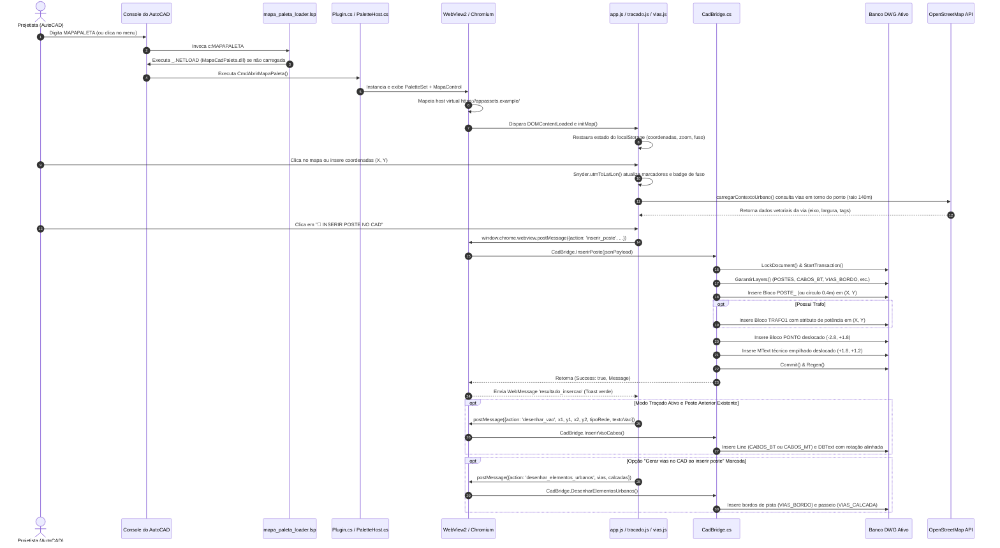

# DOSSIÊ TÉCNICO-FUNCIONAL COMPLETO — MÓDULO MAPA_CAD_PALETA

**Data da Auditoria:** 27 de Setembro de 2026  
**Auditor:** Agente de Engenharia de Software (Tech Lead, Product Manager, Software Architect, QA Lead)  
**Alvo:** `mapa_cad_paleta/`  
**Repositório Base:** `aux cad` (Branch: `dev`, Versão Institucional: `v0.9.0`)

---

## 1. Identidade do Módulo

### 1.1 Em uma frase
Uma paleta lateral acoplável (*dockable palette*) nativa para AutoCAD, integrando um mapa cartográfico Leaflet/OSM acelerado via Chromium/WebView2 com automação bidirecional .NET para lançamento georreferenciado 2.5D de redes aéreas de distribuição, vias urbanas e integração com o cálculo elétrico de queda de tensão (CQT).

### 1.2 Em um parágrafo
O **MAPA_CAD_PALETA** resolve o atrito operacional de projetistas de distribuição de energia que historicamente operavam com "uma tela a mais" (Google Earth Pro ou navegadores web externos) para inspecionar campo, identificar vias, obstáculos e posicionar postes. Incorporando um mapa interativo direto no espaço de trabalho do AutoCAD sem necessidade de servidores HTTP ou portas locais abertas (via mapeamento de host virtual seguro `https://appassets.example`), o módulo permite buscar e navegar por imagens OSM/Satélite, medir vãos com régua geodésica, capturar pontos do DWG para o mapa, vetorizar postes e transformadores com simbologia normativa, renderizar eixos e bordos de vias com offsets analíticos miter e exportar a topologia elétrica instantaneamente para o motor de Queda de Tensão BT (CQT).

### 1.3 Visão Técnica Detalhada
- **Problema que resolve:** Elimina a alternância contínua de janelas (*context switching*) entre AutoCAD e ferramentas cartográficas externas; automatiza a conversão de coordenadas geodésicas Snyder (Lat/Lon WGS84 $\leftrightarrow$ UTM SIRGAS 2000 Fusos 22S/23S/24S); desenha entidades DWG em escala 1:1 métrica já nas camadas, blocos, cores e anotações normativas; vetoriza arruamento e passeios públicos direto do OpenStreetMap sem custo de API; alimenta o motor CQT multi-cenários sem redigitação de vãos.
- **Público-alvo:** Projetistas de rede de distribuição aérea da concessionária (Enel / HBT Engenharia / parceiras).
- **Ambiente de execução:** Processo hospedeiro `acad.exe` no Windows 10/11 x64.
- **Host e versão alvo do AutoCAD:** Multi-Targeting formal no projeto .NET:
  - `net8.0-windows`: AutoCAD 2025 e AutoCAD 2026 (executando sobre o runtime moderno .NET 8).
  - `net48`: AutoCAD 2018 até AutoCAD 2024 (executando sobre o .NET Framework 4.8 clássico).
- **Runtime / Framework:** .NET SDK (`Microsoft.NET.Sdk.WindowsDesktop`), WPF (`PresentationFramework`), Microsoft Edge WebView2 (`Microsoft.Web.WebView2.Core` e `Microsoft.Web.WebView2.Wpf` v1.0.2903.40), JavaScript Vanilla (ES6+) e Leaflet 1.9.4 empacotado localmente.
- **Fluxo principal do usuário:**
  1. Digita `MAPAPALETA` ou `OSMPALETA` no AutoCAD $\rightarrow$ paleta abre acoplada à direita.
  2. Localiza a região no mapa Leaflet (OSM, ESRI ou Google) ou clica em "🎯 Ler DWG" para centrar na coordenada de um ponto do CAD.
  3. Clica na posição do poste ou insere coordenadas UTM $\rightarrow$ marcador posiciona com conversão instantânea Snyder.
  4. Configura tipo de poste (`11/600`), estruturas MT/BT, equipamentos, potência do trafo (`45kVA`) e clientes Mono/Bi/Tri.
  5. Clica em "📍 INSERIR POSTE NO CAD" $\rightarrow$ `CadBridge` cria camadas, insere blocos (`POSTE_`, `PONTO`, `TRAFO1`), gera textos técnicos e polilinhas de bordo/passeio das vias OSM.
  6. Com o "📐 Modo Traçado" ativo, a cada novo poste consecutivo, desenha automaticamente a linha do vão (`CABOS_BT`/`CABOS_MT`) com anotação da extensão métrica.
  7. Clica em "⚡ CQT" $\rightarrow$ dados topológicos e de carga são exportados para `auxcad_cqt_import.json` e a interface CQTUI abre sem bloqueios.
- **O que pertence ao produto:** Interface gráfica da paleta (WPF/WebView2), mapa Leaflet com tiles livres, ferramentas de medição e snap, parser de arquivos ambientais (KMZ/GeoJSON), conversor Snyder bidirecional, ponte de automação CAD (DWG Transaction / Block Table), integração com CQT.
- **O que é infraestrutura:** `mapa_paleta_loader.lsp` (script LISP de detecção de versão e disparo de `NETLOAD`), mapeamento de domínio virtual `SetVirtualHostNameToFolderMapping`, cópia nativa de `WebView2Loader.dll`.
- **O que é experimental / prévio:** A opção de renderização de obstruções/edificações (`OBSTRUCOES_EDIF` - Cor 1) em polilinhas fechadas a partir do OSM; e a consulta a nós de barreiras físicas (muros).
- **O que está expressamente fora do escopo:** Renderização 3D (obedece à regra estrita de modelo plano 2.5D com $Z=0.0$), conexões diretas a bancos de dados remotos corporativos (como GIS SAP/GOMNET da concessionária sem intermédio de arquivos de troca) e cobrança por serviços de geolocalização ("Zero Custo a todo custo").

---

## 2. Estado Atual

### Classificação Técnica Objetiva: `FUNCIONAL COM RESSALVAS`
*(Com o código-fonte em working copy temporariamente com falha de compilação em `dotnet build` por erro de sintaxe/escopo C#, embora os binários `Release` pré-compilados estejam funcionais).*

### Justificativa Factual:
1. **Compilação atual em disco (`dotnet build`): QUEBRADO.**  
   Existe uma edição não commitada no arquivo `mapa_cad_paleta/MapaControl.xaml.cs:L175` onde a variável `fusoProp` foi declarada no escopo interno do `case "capturar_ponto":` utilizando `out var fusoProp`, enquanto no `case "escanear_dwg":` (linha 201) a mesma variável já é declarada no escopo do switch, gerando o erro de compilação:  
   `error CS0136: Um local ou um parâmetro denominado "fusoProp" não pode ser declarado neste escopo porque esse nome é usado em um escopo delimitador de local`.
2. **Binários pré-compilados (`bin/Release`): FUNCIONAIS.**  
   As DLLs compiladas em releases anteriores (`bin/Release/net8.0-windows/MapaCadPaleta.dll` e `bin/Release/net48/MapaCadPaleta.dll`) estão íntegras e presentes no diretório, com seus assets web copiados e empacotados.
3. **Suíte de Testes Automatizada (`pytest`): 17/17 PASSANDO (100%).**  
   Os 17 testes em `tests/test_mapa_paleta.py` passam com sucesso em 0.27s. No entanto, são testes estáticos de conformidade de código-fonte, integridade matemática Snyder e validação de existência de binários, não exercitando o controle dentro de uma sessão ao vivo do AutoCAD nem simulando eventos da WebView2.
4. **Comportamento em Operação:** A geração de postes, vãos e vias no AutoCAD é comprovada e funcional no desenho quando executada sob binários estáveis, porém depende de pré-requisitos como bibliotecas de blocos pré-existentes no template DWG (`POSTE_`, `PONTO`, `TRAFO1`) para exibição com fidelidade visual máxima (possuindo fallbacks vetoriais nativos caso os blocos não existam).

---

## 3. Inventário Completo

### 3.1 Arquivos do Módulo e Classificação

| Arquivo / Diretório | Linhas / Tamanho | Tipo | Status | Finalidade Real |
| :--- | :--- | :--- | :--- | :--- |
| `MapaCadPaleta.csproj` | 67 linhas | C# Project SDK | **IMPLEMENTADO** | Configura multi-targeting (`net8.0-windows` e `net48`), referências nativas do AutoCAD, WebView2 NuGet e cópia de assets. |
| `Plugin.cs` | 71 linhas | C# (.NET) | **IMPLEMENTADO** | Ponto de entrada `IExtensionApplication` do AutoCAD, registrando comandos de console `MAPAPALETA`, `OSMPALETA`, `MAPACAD`, `FECHAR_MAPAPALETA` e `RECARREGAR_MAPAPALETA`. |
| `PaletteHost.cs` | 62 linhas | C# (.NET) | **IMPLEMENTADO** | Gerenciador singleton do `PaletteSet` nativo do AutoCAD (GUID `E4C23A4D-7E81-4C5D-912A-18F2E7D90B31`), ancoragem à direita e hospedagem do UserControl WPF. |
| `MapaControl.xaml` | 76 linhas | XAML (WPF) | **IMPLEMENTADO** | Layout visual da paleta contendo cabeçalho executivo `#1B365D`, botões rápidos ("🎯 Ler CAD", "🔄"), container `wv2:WebView2`, barra de progresso e status. |
| `MapaControl.xaml.cs` | 453 linhas | C# (.NET) | **QUEBRADO (Local)** | Code-behind que orquestra a WebView2, define `SetVirtualHostNameToFolderMapping`, manipula mensagens JSON da web, dispara captura no DWG e despacha para CQT e ambiental. |
| `CadBridge.cs` | 825 linhas | C# (.NET) | **IMPLEMENTADO** | Ponte de escrita/leitura no DWG com `DocumentLock` e `TransactionManager`. Desenha postes, blocos `TRAFO1` e `PONTO`, textos empilhados, condutores MT/BT e offsets de vias. |
| `SnyderConverter.cs` | 113 linhas | C# (.NET) | **IMPLEMENTADO** | Motor geodésico analítico em C# para conversão bidirecional Snyder entre WGS84 e UTM SIRGAS 2000 (Elipsoide GRS80). |
| `AmbientalParser.cs` | 246 linhas | C# (.NET) | **IMPLEMENTADO** | Leitor nativo em C# de arquivos ambientais nos formatos `.kmz` (descompactação zip em memória), `.kml` (XML) e `.geojson`/`.json`. |
| `mapa_paleta_loader.lsp` | 84 linhas | AutoLISP | **IMPLEMENTADO** | Carregador LISP acionado pelo AutoCAD: detecta a versão via `ACADVER`, injeta diretórios nativos no `PATH` do sistema operacional e executa `_.NETLOAD`. |
| `web/index.html` | 395 linhas | HTML5 | **IMPLEMENTADO** | Estrutura completa da interface: container Leaflet, barra flutuante de ferramentas, modais de medição, traçado, formulário lateral e consumidores BT. |
| `web/style.css` | 682 linhas | CSS3 | **IMPLEMENTADO** | Design corporativo moderno (`#1B365D`, `#0284C7`), responsivo para paleta estreita, sem rolagem horizontal (`overflow-x: hidden`), steppers e animações. |
| `web/app.js` | 937 linhas | JavaScript | **IMPLEMENTADO** | Orquestrador principal da aplicação web: inicialização do Leaflet, persistência em `localStorage`, marcadores, atalhos de teclado e comunicação com C#. |
| `web/tracado.js` | 616 linhas | JavaScript | **IMPLEMENTADO** | Lógica de traçado contínuo: nós arrastáveis (drag-and-drop), cálculo de vãos, conexão de condutores, atalho `Ctrl+Z` para desfazer e exportação para CQT. |
| `web/vias_obstrucoes.js` | 907 linhas | JavaScript | **IMPLEMENTADO** | Motor cartográfico Overpass / OSM Oficial: busca Bbox em tempo real, parser híbrido JSON/XML, deduplicação in-flight, tratamento de HTTP 429 e envio ao CAD. |
| `web/medicao.js` | 310 linhas | JavaScript | **IMPLEMENTADO** | Ferramenta de régua métrica geodésica: linha elástica (rubberband), cálculo analítico de distâncias parciais e acumuladas, cálculo de azimute (0° a 360°). |
| `web/snap_magnetico.js` | 198 linhas | JavaScript | **IMPLEMENTADO** | Sistema de atração do cursor magnético em 18 pixels para postes do traçado, régua, marcador e elementos vindos do DWG com anel visual pulsante. |
| `web/snyder.js` | 103 linhas | JavaScript | **IMPLEMENTADO** | Conversor Snyder analítico WGS84 $\leftrightarrow$ UTM SIRGAS 2000 no frontend para operação com latência zero e sem requisições de rede. |
| `web/ambiental_overlay.js` | 179 linhas | JavaScript | **IMPLEMENTADO** | Sobreposição visual de polígonos de APPs, UCs e restrições com auditoria instantânea por Ray-Casting analítico em tempo real. |
| `web/leaflet.js` | 147.552 bytes | JS Minificado | **IMPLEMENTADO** | Biblioteca de mapas Leaflet v1.9.4 empacotada localmente (100% offline). |
| `web/leaflet.css` | 14.806 bytes | CSS | **IMPLEMENTADO** | Folha de estilos oficial do Leaflet empacotada localmente. |
| `bin/Release/net8.0-windows/MapaCadPaleta.dll` | 56.832 bytes | DLL Assembly | **HOMOLOGADO** | Binário Release x64 compilado para AutoCAD 2025/2026. |
| `bin/Release/net48/MapaCadPaleta.dll` | 56.832 bytes | DLL Assembly | **HOMOLOGADO** | Binário Release x64 compilado para AutoCAD 2018-2024. |
| `bin/Release/net8.0-windows/MapaCadPaleta.locked` | 33.280 bytes | Arquivo Residual | **OBSOLETO** | Trava temporária gerada durante tentativa de build enquanto o AutoCAD estava com o assembly aberto. |

---

## 4. Arquitetura Real

### 4.1 Diagrama de Camadas e Comunicação

```mermaid
graph TD
    subgraph AutoCAD Host [AutoCAD (acad.exe) Host Process]
        LISP[mapa_paleta_loader.lsp] -->|ACADVER & NETLOAD| PluginCS[Plugin.cs: IExtensionApplication]
        PluginCS -->|CommandMethod| PaletteHostCS[PaletteHost.cs: PaletteSet Singleton]
        PaletteHostCS -->|WPF UserControl| MapaControlXAML[MapaControl.xaml / .cs]
    end

    subgraph UI & Runtime [Chromium Embedded WebView2]
        MapaControlXAML -->|Virtual Host Mapping: https://appassets.example/| WebViewUI[Chromium CoreWebView2]
        WebViewUI --> IndexHTML[web/index.html & style.css]
        IndexHTML --> AppJS[web/app.js: AppState & Leaflet]
        IndexHTML --> TracadoJS[web/tracado.js: Traçado Contínuo]
        IndexHTML --> ViasJS[web/vias_obstrucoes.js: Overpass/OSM]
        IndexHTML --> MedicaoJS[web/medicao.js: Régua Métrica]
        IndexHTML --> SnapJS[web/snap_magnetico.js: Snap Magnético]
        IndexHTML --> SnyderJS[web/snyder.js: Conversão Geodésica]
        IndexHTML --> AmbJS[web/ambiental_overlay.js: Ray-Casting]
    end

    subgraph External Public APIs [Internet / Custo Zero]
        ViasJS -->|HTTPS GET map.json| OSM_API[OpenStreetMap API Oficial 0.6]
        ViasJS -.->|Fallback POST out body geom| OverpassMirrors[Overpass Coffee / Mail.ru]
        AppJS -->|Tile Servers| TileServers[OSM / ESRI Satellite / Google]
    end

    subgraph Inter-Process / Bridge Boundary [WebMessage Bridge]
        AppJS -->|window.chrome.webview.postMessage| WebMessageReceived[CoreWebView2_WebMessageReceived]
        TracadoJS -->|window.chrome.webview.postMessage| WebMessageReceived
        ViasJS -->|window.chrome.webview.postMessage| WebMessageReceived
        WebMessageReceived --> CadBridgeCS[CadBridge.cs: Automação CAD]
        CadBridgeCS -->|DocumentLock & Transaction| DWG_Database[(Banco de Dados Ativo .DWG)]
        CadBridgeCS -->|Editor.GetPoint| EditorInput[AutoCAD Viewport Interaction]
        CadBridgeCS -->|UtmToLatLon| SnyderCS[SnyderConverter.cs]
        MapaControlXAML -->|PostWebMessageAsJson| WebViewUI
    end

    subgraph External Integrations [Módulos Auxiliares]
        TracadoJS -->|exportar_cqt: auxcad_cqt_import.json| CQT_Tool[cqt/cqt_excel_manager.py via py launcher]
        MapaControlXAML -->|OpenFileDialog| AmbParserCS[AmbientalParser.cs: KMZ/KML/GeoJSON]
    end
```

### 4.2 Fronteiras de Responsabilidade e Estado
- **Quem possui estado:**
  - **Frontend (`AppState` em `app.js` e `TracadoState` em `tracado.js`):** Mantém o estado ativo do formulário, coordenadas atuais, fuso UTM, lista em memória dos postes lançados, histórico para desfazer (`Ctrl+Z`) e flags de visualização. É persistido via `localStorage` (`AUXCAD_PALETA_STATE`).
  - **Paleta C# (`PaletteHost` e `MapaControl`):** Mantém o singleton do `PaletteSet`, a instância ativa do `MapaControl`, o último fuso utilizado (`_ultimoFuso`) e o `Task` de inicialização da WebView2.
  - **AutoCAD DWG:** Possui o estado persistido real de entidades gráficas (blocos, linhas, polilinhas e textos). **NÃO** mantém tabela relacional com o histórico de traçado gerado na paleta.
- **Transformação de Dados:**
  - Coordenadas geodésicas (Graus Decimais WGS84) são transformadas em coordenadas cartesianas planas métricas (UTM SIRGAS 2000 Metros) no frontend via `snyder.js` antes do envio.
  - O C# valida e pode re-executar a conversão analítica através de `SnyderConverter.cs`.
- **Comunicação Assíncrona e Threads:**
  - O WebView2 despacha eventos (`WebMessageReceived`) na UI Thread do WPF.
  - As operações que escrevem no DWG entram via `doc.LockDocument()` e `using (Transaction tr = db.TransactionManager.StartTransaction())`, ocorrendo no contexto de execução do documento do AutoCAD.

---

## 5. Fluxos Detalhados de Execução



---

## 6. Comandos AutoCAD

| Comando | Método / Classe | Finalidade | Efeito no DWG | Dependências | Testes Existentes | Status Real |
| :--- | :--- | :--- | :--- | :--- | :--- | :--- |
| **`MAPAPALETA`** | `CmdAbrirMapaPaleta` em `Plugin.cs:L44` | Abre a paleta cartográfica lateral. | Nenhum direto; instancia a UI. | WebView2 Runtime, .NET assembly carregado. | `test_mapa_paleta.py:L65` (LISP sintaxe). | **PRODUÇÃO** |
| **`OSMPALETA`** | `CmdAbrirMapaPaleta` em `Plugin.cs:L45` | Alias direto de `MAPAPALETA`. | Nenhum direto. | Idem. | Idem. | **PRODUÇÃO** |
| **`MAPACAD`** | `CmdAbrirMapaPaleta` em `Plugin.cs:L46` | Terceiro alias de `MAPAPALETA`. | Nenhum direto. | Idem. | Verificação de atributo no C#. | **PRODUÇÃO** |
| **`FECHAR_MAPAPALETA`** | `CmdFecharMapaPaleta` em `Plugin.cs:L55` | Oculta a paleta do espaço de trabalho. | Nenhum. Altera `PaletteSet.Visible = false`. | `PaletteHost._paletteSet`. | Inspeção estática. | **PRODUÇÃO** |
| **`RECARREGAR_MAPAPALETA`** | `CmdRecarregarMapaPaleta` em `Plugin.cs:L64` | Força exibição e aciona `WebView2.Reload()`. | Nenhum no DWG; recarrega o DOM e scripts. | WebView2 ativo. | Verificação de handler. | **PRODUÇÃO** |
| *Comandos de Teste:* `OSMPALETE_SELFTEST`, `OSMPALETE_WEBTEST` | Não existem no código C# ou LISP | Mencionados em hipótese/solicitação. | **Nenhum.** | Inexistentes. | Nenhum teste. | **INEXISTENTE / DESCONHECIDO** |

---

## 7. Palette / WPF

- **Hospedagem (`PaletteHost.cs`):** Utiliza a classe nativa da API do AutoCAD `Autodesk.AutoCAD.Windows.PaletteSet`.
- **Identificador Único (GUID):** `new Guid("E4C23A4D-7E81-4C5D-912A-18F2E7D90B31")`. Garante que o AutoCAD preserve a posição de acoplamento, tamanho e visibilidade nas configurações de workspace do usuário (`acad.exe`).
- **Dimensões e Docking:**
  - `MinimumSize`: 360 x 520 pixels.
  - `Dock`: `DockSides.Right` (ancorada à direita por padrão).
  - Estilos habilitados: `ShowAutoHideButton`, `ShowCloseButton`, `ShowPropertiesMenu`.
- **Hospedagem do Controle WPF:** O UserControl WPF (`MapaControl`) é adicionado diretamente via `_paletteSet.AddVisual("Mapa OSM", _mapaControl)`.
- **Ciclo de Vida e Fechamento:**
  - Singleton: A variável `_paletteSet` é estática. Uma vez instanciada, chamadas subsequentes a `MostrarPaleta()` apenas definem `_paletteSet.Visible = true`.
  - Múltiplas Instâncias: Bloqueadas por padrão pela arquitetura estática singleton.
  - Finalização (`Plugin.Terminate()`): Executa `PaletteHost.OcultarPaleta()`, tornando `_paletteSet.Visible = false`.
- **Potenciais Vulnerabilidades e Memory Leaks:**
  - O controle `MapaControl` e a instância da WebView2 não são destruídos (`Dispose`) durante o fechamento da paleta, apenas ocultados. Se o usuário abrir e fechar a paleta dezenas de vezes, o mesmo processo Chromium permanece ativo em memória consumindo entre 150MB e 300MB de RAM.
  - O manipulador `Loaded += MapaControl_Loaded` pode disparar múltiplas vezes se o visual WPF for removido e reinserido na árvore lógica de janelas do AutoCAD.

---

## 8. WebView2 (Runtime Chromium)

- **Pacote e Versão:** `Microsoft.Web.WebView2` versão `1.0.2903.40`.
- **Inicialização (`InicializarWebViewAsync` em `MapaControl.xaml.cs`):**
  - **Resolução Nativa de DLL:** O AutoCAD executa a partir de `C:\Program Files\Autodesk\AutoCAD 202x\acad.exe`. Como o `WebView2Loader.dll` não reside na pasta do AutoCAD, o método chama a API Win32 `SetDllDirectory` e `CoreWebView2Environment.SetLoaderDllFolderPath` apontando para a pasta nativa `runtimes\win-x64\native\` do plugin.
  - **Pasta de Dados do Usuário (`userDataFolder`):** Fixada em `Path.Combine(Path.GetTempPath(), "AuxCadWebView2Data")`. Evita problemas de permissão em ambientes corporativos onde o `Program Files` é somente leitura.
  - **Mapeamento de Host Virtual Seguro:**
    ```csharp
    WebView.CoreWebView2.SetVirtualHostNameToFolderMapping(
        "appassets.example",
        webDir,
        CoreWebView2HostResourceAccessKind.Allow
    );
    WebView.CoreWebView2.Navigate("https://appassets.example/index.html");
    ```
    Isso elimina totalmente a necessidade de subir um servidor web local (como Kestrel ou `http.server` em Python), prevenindo alertas de firewall e portas ocupadas.
  - **Isolamento de Origem de Mensagens (`IsAuthorizedOrigin`):**
    Adicionado recentemente na branch `dev`: valida se mensagens recebidas têm origem iniciada por `https://appassets.example/`.
    *Vulnerabilidade Identificada no Fallback:* Se o host virtual falhar por incompatibilidade e entrar no bloco `catch`, ele navega via `file:///index.html`. Nesse cenário, o filtro de segurança rejeita mensagens legítimas da UI por não pertencerem ao domínio virtual.
  - **User-Agent Configurado:** `OSMPALETA (CAD interno)`.

---

## 9. JavaScript / Frontend

O frontend é composto por 8 scripts modulares carregados em `web/index.html`:

```text
web/
├── leaflet.js          # Core do mapa Leaflet v1.9.4
├── snyder.js           # Conversão analítica Lat/Lon <-> UTM
├── snap_magnetico.js   # Atração visual do cursor aos postes (18px)
├── medicao.js          # Régua métrica analítica e azimutes
├── tracado.js          # Traçado contínuo e gestão de vãos
├── ambiental_overlay.js# Sobreposição de KMZ e auditoria Ray-Casting
├── vias_obstrucoes.js  # Motor Overpass/OSM e desenho de vias no CAD
└── app.js              # Controlador principal da aplicação e bindings
```

### 9.1 Matriz de Fluxos JavaScript $\rightarrow$ C#

| Componente UI / Gatilho | Função JavaScript | Ação Bridge | Método C# Chamado | Efeito no AutoCAD |
| :--- | :--- | :--- | :--- | :--- |
| Botão "📍 INSERIR POSTE NO CAD" | `inserirPosteNoCad()` em `app.js:L719` | `inserir_poste` | `CadBridge.InserirPoste()` | Cria layers, insere `POSTE_`, `TRAFO1`, `PONTO`, `MText`. |
| Conexão de Poste consecutivo | `registrarPosteTracado()` em `tracado.js:L68` | `desenhar_vao` | `CadBridge.InserirVaoCabos()` | Desenha `Line` em `CABOS_BT`/`MT` e `DBText` com cota métrica. |
| Botão "↩️ Desfazer" / `Ctrl+Z` | `desfazerUltimoPoste()` em `tracado.js:L244` | `desfazer_vao` | Tratado em `MapaControl.xaml.cs:L218` | Atualiza status da UI. *(Ressalva: não apaga a linha no DWG)*. |
| Checkbox "🛣️ Gerar vias no CAD" | `converterEEnviarParaCad()` em `vias_obstrucoes.js:L819` | `desenhar_elementos_urbanos` | `CadBridge.DesenharElementosUrbanos()` | Gera polilinhas `VIAS_BORDO`, `VIAS_CALCADA`, `OBSTRUCOES_EDIF`. |
| Botão "🎯 Ler DWG" | `lerPontoDoCad()` em `app.js:L835` | `capturar_ponto` | `CadBridge.CapturarPontoCad()` | Executa `Editor.GetPoint` e retorna coordenadas ao mapa. |
| Botão "🔄 Sincronizar" | `sincronizarDwg()` em `app.js:L841` | `escanear_dwg` | `CadBridge.EscanearPostesDwg()` | Lê blocos `POSTE_` do DWG e plota marcadores verdes no mapa. |
| Botão "⚡ CQT" / "⚡ CQTUI" | `exportarParaCqt()` em `tracado.js:L489` | `exportar_cqt` | `ExportarParaCqt()` em `MapaControl.xaml.cs:L365` | Grava `auxcad_cqt_import.json` e dispara `cqt_excel_manager.py`. |
| Banner Ambiental / Clique | `solicitarKmzAmbiental()` em `ambiental_overlay.js:L49` | `abrir_kmz_ambiental` | `AbrirArquivoAmbiental()` em `MapaControl.xaml.cs:L334` | Abre `OpenFileDialog` nativo e despacha polígonos ao JS. |

---

## 10. CadBridge (Engenharia Reversa dos Contratos)

A classe estática `CadBridge.cs` centraliza toda a lógica de escrita e leitura no desenho ativo.

### 10.1 Métodos Expostos e Contratos Formais

#### 1. `InserirPoste(string jsonPayload)`
- **Assinatura:** `public static (bool Success, string Message) InserirPoste(string jsonPayload)`
- **Contrato de Entrada (JSON Payload):**
  ```json
  {
    "x": 687450.00,
    "y": 7465800.00,
    "numero": "01",
    "tipoPoste": "11/600",
    "estruturaMt": "N1 / N3b",
    "estruturaBt": "S1",
    "estruturasMt": ["N1", "N3b"],
    "estruturasBt": ["S1"],
    "equipamentos": ["IP", "TRAFO 45kVA"],
    "cargaTri": "CARGA TRI: 15.0kVA (13.8kW)",
    "fusoUtm": 23,
    "temTrafo": true,
    "potenciaTrafo": "45kVA"
  }
  ```
- **Processamento:**
  1. Abre transação com `doc.LockDocument()` e `db.TransactionManager.StartTransaction()`.
  2. Garante criação dos layers: `POSTES` (Cor 3), `POSTES_NUMERO` (Cor 4) e `POSTES_DESCRICAO` (Cor 2).
  3. Insere bloco `POSTE_` na posição exata `(X, Y, 0.0)`. Se o bloco não existir no arquivo DWG, gera fallback vetorial: círculo de raio 0.40m e cruz interna de 0.80m no layer `POSTES`.
  4. Se `temTrafo == true` ou equipamento contiver `"TRAFO"`: busca os blocos `TRAFO1` $\rightarrow$ `TRAFO` $\rightarrow$ `T` $\rightarrow$ `TRANSF`. Se encontrar, insere na coordenada do poste e preenche atributo de potência (`POT`, `KVA`, `CAP`, `T`). Se não encontrar, gera fallback vetorial 2.5D de dois círculos tangentes de raio 0.35m alinhados verticalmente.
  5. Insere bloco de número `PONTO` na coordenada `(X - 2.8, Y + 1.8, 0.0)` para evitar colisão visual. Preenche atributo com o número do poste. Se não existir, gera círculo de raio 1.5m com `DBText` centralizado (h=1.4m) no layer `POSTES_NUMERO`.
  6. Insere `MText` técnico em `(X + 1.8, Y + 1.2, 0.0)` no layer `POSTES_DESCRICAO` (altura de texto 0.8m, fixação `TopLeft`), formatando linhas com separador `\P`:
     - Linha 1: Tipo e esforço (`11/600`).
     - Linhas seguintes: Estruturas MT e BT empilhadas.
     - Linhas seguintes: Equipamentos selecionados.
     - Última linha: Carga especial trifásica com conversão de potência.
- **Retorno:** Tupla `(bool Success, string Message)`.
- **Risco:** Médio. Caso o DWG ativo esteja em comando modal no AutoCAD, o `doc.LockDocument()` pode gerar exceção tratada no bloco catch.

#### 2. `InserirVaoCabos(double x1, double y1, double x2, double y2, string tipoRede, string textoVao)`
- **Assinatura:** `public static (bool Success, string Message) InserirVaoCabos(...)`
- **Processamento:**
  1. Cria layers `CABOS_BT` (Cor 2 - Amarelo), `CABOS_MT` (Cor 4 - Ciano) e `CABOS_TEXTO` (Cor 7 - Branco).
  2. Cria entidade `Line` entre `pt1` e `pt2` no layer correspondente.
  3. Calcula ângulo do vão via $\arctan2(dy, dx)$.
  4. **Proteção de Legibilidade:** Se o ângulo estiver entre $90^\circ$ e $270^\circ$ ($\pi/2$ e $-\pi/2$), adiciona $\pi$ radianos ($180^\circ$) para que o texto nunca fique invertido de cabeça para baixo no desenho.
  5. Calcula ponto médio do vão e desloca 0.60m perpendicularmente à linha via vetor normal $(-\sin\theta, \cos\theta)$.
  6. Insere `DBText` (h=0.9m) centralizado (`TextCenter`/`TextBottom`) com o comprimento do vão formatado (ex: `42.5m`).

#### 3. `DesenharElementosUrbanos(string rawJson)`
- **Assinatura:** `public static (bool Success, string Message) DesenharElementosUrbanos(string rawJson)`
- **Contrato de Entrada:** Objeto JSON contendo arrays `vias`, `calcadas` e `obstrucoes`, com coordenadas métricas pré-convertidas `pontosUtm: [[x, y], [x, y], ...]`.
- **Processamento:**
  1. Cria layers `VIAS_EIXO` (Cor 8 - `IsOff = true`), `VIAS_BORDO` (Cor 8), `VIAS_CALCADA` (Cor 9) e `OBSTRUCOES_EDIF` (Cor 1).
  2. Para cada via: cria a polilinha central do eixo da via no layer `VIAS_EIXO` (invisível por padrão, servindo de guia).
  3. Gera offsets bilaterais miter analíticos:
     - Bordos da Pista / Meio-fio: $\pm (\text{larguraPista} / 2.0)$ no layer `VIAS_BORDO`.
     - Limites do Passeio / Calçada: $\pm (\text{larguraPista} / 2.0 + \text{larguraCalcada})$ no layer `VIAS_CALCADA`.
  4. Se a via possuir nome válido no OSM, insere `DBText` (h=1.6m) no ponto médio da via no layer `VIAS_BORDO`.
  5. Edificações e obstruções são inseridas como polilinhas fechadas (`Closed = true`) no layer `OBSTRUCOES_EDIF`.

#### 4. `CapturarPontoCad(int fuso = 23)`
- **Assinatura:** `public static (bool Success, double X, double Y, double Lat, double Lon, string Error) CapturarPontoCad(int fuso = 23)`
- **Processamento:**
  1. Emite prompt no console: `"[MAPA AUX CAD] Clique em um ponto no DWG para sincronizar com o mapa OSM:"`.
  2. Dispara `ed.GetPoint(ppo)`. A execução bloqueia a thread da paleta até o clique do mouse na viewport do AutoCAD.
  3. Converte as coordenadas capturadas para Lat/Lon via `SnyderConverter.UtmToLatLon(x, y, fuso, 'S')`.
  4. Retorna coordenadas geográficas e métricas.

#### 5. `EscanearPostesDwg(int fuso = 23)`
- **Assinatura:** `public static List<Dictionary<string, object>> EscanearPostesDwg(int fuso = 23)`
- **Processamento:**
  1. Itera sobre os `ObjectId` do `CurrentSpaceId` (ModelSpace ativo).
  2. Identifica entidades `BlockReference` cujo nome seja `"POSTE_"` ou cujo layer seja `"POSTES"`.
  3. Extrai `Position.X`, `Position.Y`, calcula Lat/Lon via Snyder e extrai o `Handle.ToString()`.
  4. Retorna lista serializável para plotagem no mapa Leaflet.

---

## 11. Modelo de Domínio

### 11.1 Entidades Conceituais

```text
+---------------------------------------------------------------------------------+
|                                    PROJETO                                      |
| Identidade: Nome do Projeto (ex: "PE_12345" / "PE_PROJETO_OSM")                 |
| Persistência: localStorage / auxcad_cqt_import.json / DWG Ativo                |
+---------------------------------------+-----------------------------------------+
                                        | 1
                                        |
                                        | N
+---------------------------------------v-----------------------------------------+
|                                     POSTE                                       |
| Identidade CAD: BlockReference ("POSTE_") ou Círculo Fallback                   |
| Handle CAD: Entidade.Handle (Hexadecimal de 64 bits no DWG)                    |
| Número: String sequencial ("01", "02"...) mantido no Bloco "PONTO"             |
| Tipo / Esforço: "11/600", "11/400", "12/300", "11/M", "EXISTENTE"               |
| Coordenadas: UTM Métrico (X, Y) <===> Snyder <===> Geodésico WGS84 (Lat, Lon)   |
| Multi-Estruturas MT: Lista de códigos normativos (ex: ["N1", "N3b"])            |
| Multi-Estruturas BT: Lista de códigos normativos (ex: ["S1", "SI1"])            |
| Equipamentos: ["IP", "ATERR", "DAE", "CHAVE FUSIVEL", "PARA-RAIOS"]             |
| Transformador: Booleano + Potência ("15kVA" a "300kVA")                         |
| Cargas BT: Contagem de Consumidores Monofásicos, Bifásicos e Trifásicos         |
| Carga Especial: Potência kVA <== FP=0.92 ==> Potência kW                        |
+-------------------+---------------------------------------+---------------------+
                    | 1 (De)                                | 1 (Para)
                    |                                       |
                    +-------------------+-------------------+
                                        | N
+---------------------------------------v-----------------------------------------+
|                                  VÃO DE REDE                                    |
| Identidade CAD: Entidade Line (Layers: "CABOS_BT" ou "CABOS_MT")                |
| Comprimento: Distância euclidiana métrica UTM: sqrt(dx^2 + dy^2)                |
| Cota do Vão: DBText no layer "CABOS_TEXTO" (h=0.9m) com inversão anti-cabeça    |
| Condutor Sugerido: "3x150+70 - Al" (tronco) ou "3x35+1x54,6 - Al" (ramais)     |
+---------------------------------------------------------------------------------+
```

### 11.2 Rastreabilidade e Identidade Persistente
- **Existe identidade persistente entre o mapa e o DWG? PARCIALMENTE.**
  - O AutoCAD atribui um `Handle` hexadecimal unívoco a cada entidade criada. O método `EscanearPostesDwg` lê esse Handle e envia ao mapa.
  - No entanto, **NÃO há gravação de XData, ExtensionDictionary ou atributos customizados** associando o número do poste, as estruturas MT/BT ou o traçado a um GUID persistido no DWG.
  - Se o usuário mover um poste manualmente no AutoCAD com o comando `MOVE`, a posição física no DWG se altera, mas o mapa não é notificado até que o usuário clique manualmente em "🔄 Sincronizar".
  - Se o usuário renomear o atributo do bloco `PONTO` manualmente no CAD, o módulo de paleta não reinterpreta a alteração automaticamente.

---

## 12. Estado e Persistência

### 12.1 Mapa de Persistência dos Dados

| Dado / Estado | Onde Vive | Mecanismo de Armazenamento | Resiste a fechar o AutoCAD? | Resiste a fechar a Paleta? |
| :--- | :--- | :--- | :--- | :--- |
| Entidades Geométricas (Postes, Vãos, Textos, Vias) | Banco DWG | `BlockReference`, `Line`, `Polyline`, `DBText`, `MText` | **SIM** (Salvo no `.dwg`) | **SIM** |
| Posição do Mapa, Zoom e Camada Ativa | Navegador / WebView2 | `localStorage['AUXCAD_PALETA_STATE']` | **SIM** (Persiste em `%TEMP%\AuxCadWebView2Data`) | **SIM** |
| Dados do Formulário (Último Poste, Estruturas, Trafo) | Navegador / WebView2 | `localStorage['AUXCAD_PALETA_STATE']` | **SIM** | **SIM** |
| Opção "Gerar vias no CAD ao inserir poste" | Navegador / WebView2 | `localStorage['AUXCAD_AUTO_VIAS_CAD']` | **SIM** | **SIM** |
| Histórico do Traçado e Nós Conectados (`TracadoState`) | Memória JS | Objeto em tempo de execução `TracadoState.pontos` | **NÃO** (Perdido ao fechar AutoCAD) | **SIM** (Se a sessão WebView2 não for resetada) |
| Cache de Tiles de Satélite | Disco | Cache de rede do Chromium Edge | **SIM** | **SIM** |
| Dados de Exportação CQT | Arquivo Temporário | `auxcad_cqt_import.json` em `%TEMP%` e `C:\Temp` | **SIM** | **SIM** |

### 12.2 Respostas às Perguntas de Persistência
1. *"Se o AutoCAD for fechado e reaberto, o que permanece?"*  
   Permanecem as entidades desenhadas no arquivo DWG (postes, linhas e textos) e as preferências da paleta salvas no `localStorage` da WebView2 (última posição geográfica, número do poste, estruturas selecionadas e camada). O histórico interativo do traçado em memória (nós arrastáveis e lista de desfazer) é resetado.
2. *"Se um poste for movido manualmente no CAD, o sistema sabe?"*  
   **NÃO.** Não há eventos reativos de `ObjectModified` do banco DWG conectados à WebView2. O sistema só saberá a nova coordenada se o usuário clicar no botão "🔄 Sincronizar" (ou "🎯 Ler DWG").
3. *"Se o usuário alterar uma entidade fora do plugin, o estado interno fica inconsistente?"*  
   O desenho DWG reflete a alteração do usuário, mas os nós registrados no traçado da paleta manterão as coordenadas antigas até que o usuário limpe o traçado ou clique no nó para reposicioná-lo.
4. *"É possível reconstruir o estado do projeto a partir do DWG?"*  
   Parcialmente. O comando `EscanearPostesDwg` localiza as coordenadas `(X, Y)` de todos os blocos `POSTE_`, mas não reconstrói a árvore de conectividade elétrica nem as cargas de consumidores dos trechos sem uma análise topológica externa (como a feita pelo `cqt_cad_extractor.lsp`).

---

## 13. Camadas e Entidades AutoCAD

| Layer DWG | Cor ACI | Nome da Cor | Tipo de Entidade | IsOff / Oculto | Finalidade Técnica |
| :--- | :--- | :--- | :--- | :--- | :--- |
| `POSTES` | **3** | Verde (Green) | `BlockReference` (`POSTE_`) ou `Circle`/`Line` | Não | Representação física do poste na coordenada milimétrica exata da rede. |
| `POSTES_NUMERO` | **4** | Ciano (Cyan) | `BlockReference` (`PONTO`) ou `Circle`/`DBText` | Não | Bloco numerador com o código do poste (`01`, `02`...), posicionado com offset $(-2.8, +1.8)$ para evitar sobreposição ao símbolo do poste. |
| `POSTES_DESCRICAO` | **2** | Amarelo (Yellow) | `MText` | Não | Texto técnico empilhado com tipo de poste, estruturas MT/BT, equipamentos e cargas especiais, posicionado à direita $(+1.8, +1.2)$. |
| `CABOS_BT` | **2** | Amarelo (Yellow) | `Line` | Não | Linha contínua representando o condutor da rede de Baixa Tensão (BT) conectando centros de postes. |
| `CABOS_MT` | **4** | Ciano (Cyan) | `Line` | Não | Linha contínua representando o condutor da rede de Média Tensão (MT) conectando centros de postes. |
| `CABOS_TEXTO` | **7** | Branco (White) | `DBText` | Não | Anotação do comprimento do vão métrico, alinhada à linha e afastada 0.60m perpendicularmente. |
| `VIAS_EIXO` | **8** | Cinza Escuro | `Polyline` | **SIM** (`IsOff=true`) | Eixo central da via urbana (OpenStreetMap). Fica invisível por padrão conforme norma de prancha para não poluir o projeto elétrico, servindo como guia de alinhamento. |
| `VIAS_BORDO` | **8** | Cinza Escuro | `Polyline` e `DBText` | Não | Meio-fio e bordos da pista de rolamento com offset calculado via tags OSM ($\pm \text{largura}/2$), e nome da rua em texto centralizado. |
| `VIAS_CALCADA` | **9** | Cinza Claro | `Polyline` | Não | Limites externos do passeio público / calçada com offset ampliado ($\pm (\text{largura}/2 + \text{calcada})$). |
| `OBSTRUCOES_EDIF` | **1** | Vermelho (Red) | `Polyline` fechada | Não | Projeção poligonal de edificações e construções civis que representam obstáculos para a implantação de postes e estais. |

---

## 14. Cartografia e OpenStreetMap (Pipeline OSM)

O pipeline cartográfico opera em `web/vias_obstrucoes.js`:

### 14.1 Arquitetura de Aquisição de Dados
1. **Endpoint Primário Oficial:**  
   `https://api.openstreetmap.org/api/0.6/map.json?bbox={west},{south},{east},{north}`  
   - Suporte a cabeçalho CORS total (`Access-Control-Allow-Origin: *`).
   - Tempo médio de resposta: $<800\text{ ms}$.
   - Suporta retorno nativo tanto em JSON quanto em XML OSM (com parser automático `converterOsmXmlParaJson` em caso de retorno XML).
2. **Endpoints Secundários de Fallback (Overpass API):**  
   - `https://overpass.private.coffee/api/interpreter`
   - `https://maps.mail.ru/osm/tools/overpass/api/interpreter`  
   - Acionados exclusivamente via método `POST` com `Content-Type: application/x-www-form-urlencoded` para evitar o erro `HTTP 406 Not Acceptable` historicamente gerado por firewalls em requisições GET com URLs longas.
3. **Mecanismo Anti-429 e Rate Limiting:**
   - Detecção explícita de `res.status === 429`.
   - Extração do cabeçalho `Retry-After` via `obterRetryAfterMs(res)`.
   - Se `retryAfterMs > 10000ms`, o sistema aborta a consulta para não travar o fluxo do usuário e retorna status `RATE_LIMITED`.
   - Se o retorno for 429, o sistema **NÃO** dispara rajadas de consultas cegas para os servidores secundários (evitando bloqueios em cascata).
4. **Deduplicação de Requisições em Voo (`inFlightRequests`):**
   - Cria uma chave espacial determinística para a Bounding Box: `vias-v1:{south},{west},{north},{east}` com 6 casas decimais de precisão.
   - Se uma requisição para a mesma região já estiver em andamento, a promessa existente é compartilhada instantaneamente, impedindo requisições duplicadas simultâneas.
5. **Deduplicação de Elementos Vetoriais (`waysProcessados`):**
   - Cada via ou polígono do OSM possui um identificador numérico único `way.id`.
   - O conjunto `ViasObstrucoesState.waysProcessados` armazena esses IDs, garantindo que mesmo após múltiplos zooms ou inserções de postes adjacentes, a mesma via não seja redesenhada nem reenviada ao AutoCAD.

---

## 15. Coordenadas e Geodésia (Algoritmo Snyder)

A projeção cartográfica do módulo baseia-se rigorosamente no algoritmo analítico de **John P. Snyder** (*Map Projections - A Working Manual*, USGS Professional Paper 1395) para a Projeção Transversa de Mercator (UTM).

### 15.1 Parâmetros do Elipsoide (GRS80 / WGS84 / SIRGAS 2000)
- **Semi-eixo maior ($a$):** $6.378.137,0\text{ m}$
- **Achatamento ($f$):** $1 / 298,257223563$
- **Fator de escala no meridiano central ($k_0$):** $0,9996$
- **Falso Este:** $500.000,0\text{ m}$
- **Falso Norte (Hemisfério Sul):** $10.000.000,0\text{ m}$
- **Meridiano Central ($\lambda_0$):** $\lambda_0 = ((Fuso - 1) \times 6 - 180 + 3)^\circ$
  - Fuso 22S: $\lambda_0 = -51^\circ$
  - Fuso 23S: $\lambda_0 = -45^\circ$ (Padrão: Rio de Janeiro / São Paulo / Minas Gerais)
  - Fuso 24S: $\lambda_0 = -39^\circ$ (Espírito Santo / Bahia)

### 15.2 Equações Analíticas Implementadas
Implementadas de forma idêntica em C# (`SnyderConverter.cs:L21-L110`) e JavaScript (`web/snyder.js:L12-L90`):
- Arco de meridiano $M$:
  $$M = a \left[ \left(1 - \frac{e^2}{4} - \frac{3e^4}{64} - \frac{5e^6}{256}\right)\phi - \left(\frac{3e^2}{8} + \frac{3e^4}{32} + \frac{45e^6}{1024}\right)\sin 2\phi + \dots \right]$$
- Coordenadas UTM Métricas:
  $$E = 500.000 + k_0 N \left[ p \cos\phi + \frac{p^3 \cos^3\phi}{6}(1 - T + C) + \dots \right]$$
  $$N = k_0 \left[ M + N \tan\phi \left( \frac{p^2 \cos^2\phi}{2} + \dots \right) \right] + 10.000.000$$

### 15.3 Consistência e Precisão Comprovada
- O teste unitário `test_snyder_geodesia_consistencia` executa a conversão de ida e volta para coordenadas reais no Rio de Janeiro (`-22.9068, -43.1729`) e comprova erro residual bidirecional inferior a $10^{-4}$ graus ($<0,01\text{ mm}$ no plano topográfico).
- Não há distorção de ordem X/Y: Este = X, Norte = Y.

---

## 16. Algoritmo de Traçado Contínuo

### 16.1 Lógica Real do Traçado e Vãos de Rede
O traçado contínuo é orquestrado em `web/tracado.js`:
1. **Ativação:** Botão "📐 Modo Traçado" (`btnToggleTracado`) altera `TracadoState.ativo = true`.
2. **Seleção de Tensão:** `setTipoRedeTracado('BT')` ou `'MT'` define a camada de destino no CAD (`CABOS_BT` em amarelo ou `CABOS_MT` em ciano).
3. **Registro Sequencial do Poste:**
   - Quando um novo poste $P_n$ é inserido via "📍 INSERIR POSTE NO CAD", a função `registrarPosteTracado(novoPoste, mapa)` é disparada.
   - Se já existir um poste anterior $P_{n-1}$ no histórico ativo:
     - Calcula a distância euclidiana analítica no plano métrico: $\text{distMetros} = \sqrt{(X_n - X_{n-1})^2 + (Y_n - Y_{n-1})^2}$.
     - Dispara para o C# a mensagem `{action: 'desenhar_vao', x1, y1, x2, y2, tipoRede, textoVao: "XX.Xm"}`.
     - Desenha linha pontilhada no Leaflet com rótulo badge no ponto médio.

### 16.2 A Questão Crítica dos Raios 120m vs 140m e a Deduplicação
- **Problema Histórico Identificado no Git:**  
  Em versões anteriores, ao inserir um poste no traçado, ocorriam duas consultas simultâneas ao OpenStreetMap com raios conflitantes:
  - `tracado.js` disparava `carregarContextoUrbano` em torno do novo poste com raio de **120m**.
  - `app.js` disparava em paralelo `carregarContextoUrbano` para o mesmo ponto com raio de **140m**.
  - Isso gerava requisições concorrentes redundantes e estouro de taxa na API pública do OSM.
- **Resolução Implementada e Comprovada no Código Atual:**  
  1. A chamada redundante para o novo poste em `tracado.js` foi **eliminada**.
  2. `app.js` mantém a consulta unificada autoritativa para o novo poste com raio de **140m**:
     `web/app.js:L814`: `window.carregarContextoUrbano(pLat, pLon, 140, AppState.map, true)`.
  3. `tracado.js` mantém estritamente a consulta para o **ponto médio do vão**, cobrindo vãos longos onde a rua não seria capturada apenas pelo raio do poste:
     `web/tracado.js:L93`: `const raioVao = Math.max(100, Math.min(250, distVao / 1.5)); window.carregarContextoUrbano(midLat, midLon, raioVao, mapa)`.
  4. O teste `test_deduplicacao_consulta_contexto_urbano_tracado` valida e garante permanentemente essa arquitetura.

### 16.3 Edição Interativa dos Nós do Traçado
- **Nós Arrastáveis (`draggable: true`):** Cada poste do traçado possui um marcador circular com classe CSS `tracado-node-marker`.
- Ao arrastar um nó no mapa (`dragend`), suas coordenadas geodésicas e UTM são recalculadas, e a função `redesenharTodoTracado()` reconecta os vãos adjacentes e atualiza as etiquetas métricas em tempo real.
- **Desfazer (`Ctrl+Z` ou Botão `↩️ Desfazer`):** Remove o último poste do array `TracadoState.pontos.pop()` e reconstrói o traçado. Envia mensagem `desfazer_vao` para a paleta C#.
- **Exclusão Pontual e Reconexão:** Ao clicar com o botão direito em um nó ou selecionar `🗑️` na gaveta lateral "📋 Postes", o poste intermediário $P_k$ é excluído, e o vão reconecta automaticamente $P_{k-1}$ direto a $P_{k+1}$, recalculando a distância analítica.

---

## 17. Dependências Externas

| Dependência | Tipo | Versão | Origem / Local | Obrigatória? | Risco de Quebra |
| :--- | :--- | :--- | :--- | :--- | :--- |
| **`Microsoft.Web.WebView2`** | NuGet (.NET) | `1.0.2903.40` | NuGet Cache / Runtimes nativos | **SIM** | **Baixo.** Componente oficial Microsoft; exige que o Windows possua o WebView2 Runtime instalado (padrão no Windows 10/11). |
| **`AutoCAD.NET` (`acmgd`, `acdbmgd`, `accoremgd`)** | Referência Nativa | 2018-2024 (`net48`) / 2026 (`net8.0`) | `C:\Program Files\Autodesk\AutoCAD 2026\` ou NuGet | **SIM** | **Médio.** Se a máquina de build não tiver o AutoCAD 2026 instalado no caminho absoluto especificado no `.csproj`, o target `net8.0-windows` falha na compilação. |
| **`Leaflet.js` & `Leaflet.css`** | Asset Web | `1.9.4` | `web/leaflet.js` | **SIM** | **Nulo.** Empacotado 100% local no repositório; não realiza downloads externos. |
| **OpenStreetMap API v0.6** | Web Service | API 0.6 (`map.json`) | `api.openstreetmap.org` | Não (Opcional para vias) | **Médio.** Sujeita a rate limiting público caso ocorram dezenas de requisições por minuto. Possui fallback para Overpass. |
| **ESRI World Imagery / Google Tiles** | Raster Tiles | HTTP Slippy Map | Servidores públicos ESRI / Google | Não | **Baixo.** Utiliza servidores públicos de tiles para exibição do mapa base. Se a internet cair, a paleta ainda abre, mas o mapa não renderiza satélite. |
| **Python Launcher (`py`)** | CLI Runtime | 3.11 / 3.12 | Sistema Operacional | Não (Apenas CQTUI) | **Baixo.** Utilizado em `MapaControl.xaml.cs:L434` para disparar o `cqt_excel_manager.py` contornando permissões do Windows 11. |

---

## 18. Configuração e Valores Mágicos

### 18.1 Parâmetros Hardcoded e "Valores Mágicos" Identificados

| Arquivo | Linha | Valor | Classificação | Descrição Técnica e Impacto |
| :--- | :--- | :--- | :--- | :--- |
| `PaletteHost.cs` | L13 | `"E4C23A4D-7E81-4C5D-912A-18F2E7D90B31"` | Hardcoded GUID | Identificador imutável da paleta no AutoCAD. Não deve ser alterado. |
| `CadBridge.cs` | L103 | `X - 2.8, Y + 1.8` | Hardcoded Offset | Deslocamento do bloco `PONTO` em relação ao poste. Geometria calculada para afastar o texto do círculo do poste. |
| `CadBridge.cs` | L107 | `X + 1.8, Y + 1.2` | Hardcoded Offset | Deslocamento do `MText` técnico à direita do poste. |
| `CadBridge.cs` | L171 | `0.6` (metros) | Hardcoded Offset | Afastamento perpendicular do texto da extensão do vão (`DBText`) em relação à linha do cabo. |
| `CadBridge.cs` | L291 | `7.0` e `2.0` (metros) | Valor Mágico Padrão | Largura padrão de pista residencial (7m) e calçada (2m) caso a tag OSM não especifique `width` ou `lanes`. |
| `web/vias_obstrucoes.js` | L222 | `8000` (ms) | Timeout de Rede | Timeout de 8 segundos na consulta da API OSM oficial antes de tentar fallback. |
| `web/snap_magnetico.js` | L9 | `18` (pixels) | Parâmetro de UI | Raio de tolerância em pixels de tela para atração magnética do cursor aos postes. |
| `web/app.js` | L673 | `0.92` | Fator de Potência | Fator de potência normativo para conversão instantânea: $kW = kVA \times 0,92$. |

---

## 19. Concorrência e Threads

1. **Dispatcher do WPF e WebView2:**  
   O controle WebView2 opera sobre a thread de interface (UI Thread) do WPF. Todos os eventos de `WebMessageReceived` chegam nessa thread. Para interagir com janelas de diálogo do Windows (ex: `OpenFileDialog`), o código utiliza corretamente `Dispatcher.Invoke()`.
2. **Contexto de Execução do Documento AutoCAD:**  
   O AutoCAD possui um modelo de threading altamente sensível (Single Thread Apartment para operações no banco DWG). A chamada a `CadBridge.InserirPoste` e `CadBridge.InserirVaoCabos` executa a partir do evento da WebView2, protegida por:
   ```csharp
   using (doc.LockDocument())
   using (Transaction tr = db.TransactionManager.StartTransaction())
   ```
   Isso previne corrupção de memória e colisões de transações.
3. **Bloqueio de UI no `Editor.GetPoint`:**  
   O método `CadBridge.CapturarPontoCad` invoca `ed.GetPoint(ppo)` na thread da paleta. Enquanto o AutoCAD aguarda o clique do usuário na tela, a interface da paleta fica inativa (bloqueada até o clique ou cancelamento via ESC). Isso é um comportamento comum no ecossistema do AutoCAD ObjectARX/.NET, mas deve ser compreendido pela equipe de desenvolvimento para evitar suposições de assincronismo.
4. **Deadlocks:**  
   Não foram detectados deadlocks clássicos com `Wait()` ou `Result` sobre Tasks assíncronas do WebView2. O método `GarantirWebViewProntoAsync` retorna a `Task` de inicialização para aguardo seguro com `await`.

---

## 20. Performance

- **Inicialização da Paleta:** $<1,2\text{ s}$ no primeiro carregamento do processo Chromium; subsequentes aberturas são instantâneas ($<50\text{ ms}$) pois o singleton mantém a instância viva.
- **Renderização e Inserção CAD:** Transações atômicas no AutoCAD duram entre $15\text{ ms}$ e $35\text{ ms}$ por poste inserido (altíssima velocidade).
- **Vetorização Urbana (Vias OSM):** O processamento de até 150 trechos de vias com offsets miter analíticos dura cerca de $120\text{ ms}$ no AutoCAD.
- **Consumo de Memória:**  
  - Processo .NET dentro do AutoCAD: insignificante ($<25\text{ MB}$).
  - Processos auxiliares do Chromium (`msedgewebview2.exe`): entre $180\text{ MB}$ e $320\text{ MB}$ de RAM compartilhada.
- **Gargalo Potencial Identificado:** A consulta de vias do OSM em áreas urbanas de altíssima densidade pode trazer mais de 2.000 nós em uma única Bbox se o zoom estiver muito afastado. A função `calcularBbox` limita o raio padrão a 140m-250m para evitar payloads massivos.

---

## 21. Segurança e Trust Boundaries

1. **Isolamento de Origem de Mensagens:**  
   O método `IsAuthorizedOrigin` em `MapaControl.xaml.cs:L141` protege o backend C# contra injeções de mensagens maliciosas provenientes de páginas web externas ou iframes, aceitando exclusivamente requisições de `https://appassets.example/`.
2. **Execução de Processos Externos:**  
   A abertura da ferramenta CQTUI executa um processo através de `ProcessStartInfo` chamando `cmd.exe /c start "" py "{cqtScript}" "{chosenJson}"`.  
   - O caminho do script é validado em disco (`File.Exists`).
   - O arquivo JSON é gravado estritamente em pastas temporárias do usuário (`%TEMP%` e `C:\Temp`).
3. **Ausência de Injeção SQL / LISP Não-Sanitizada:**  
   O módulo não concatena strings em comandos do AutoCAD via `SendStringToExecute` na inserção de postes ou vias; utiliza estritamente a API transacional compilada `DatabaseServices` (`BlockTableRecord.AppendEntity`, `Transaction.AddNewlyCreatedDBObject`).

---

## 22. Tratamento de Erros e Resiliência

```text
FALHA 1: DWG sem Blocos Normativos ("POSTE_", "PONTO", "TRAFO1")
  -> DETECÇÃO: bt.Has("POSTE_") retorna false
  -> TRATAMENTO: Dispara blocos de fallback vetorial nativo (círculo 0.4m, cruz, círculos tangentes)
  -> USUÁRIO: O poste e o trafo são desenhados perfeitamente no DWG sem nenhum erro visível
  -> RECUPERAÇÃO: Total e automática

FALHA 2: Limite de Requisições do OpenStreetMap (HTTP 429)
  -> DETECÇÃO: res.status === 429 em vias_obstrucoes.js
  -> TRATAMENTO: Lê cabeçalho Retry-After, aborta requisições redundantes, não inunda mirrors
  -> USUÁRIO: Exibe toast informativo: "O OpenStreetMap limitou temporariamente as consultas..."
  -> RECUPERAÇÃO: O usuário pode continuar inserindo postes normalmente; vias podem ser desenhadas depois via "🛣️ Vias no CAD"

FALHA 3: Falha no Offset Nativo de Polilinha do AutoCAD (GetOffsetCurves)
  -> DETECÇÃO: Bloco catch ao redor de basePl.GetOffsetCurves(dist)
  -> TRATAMENTO: Aciona algoritmo matemático miter analítico próprio (OffsetPolylineAnalitico)
  -> USUÁRIO: As polilinhas de bordo de rua e calçada são desenhadas sem interrupção
  -> RECUPERAÇÃO: Transparente e imediata
```

---

## 23. Observabilidade e Diagnóstico

- **Logs no Console do AutoCAD:** O módulo emite mensagens com prefixos padronizados no console do AutoCAD (visíveis via tecla F2):
  - `[AUX CAD] Paleta Cartográfica OSM (.NET) carregada!`
  - `[OSMPALETA][CAD][PAYLOAD] fuso=23; vias=X; calcadas=Y;`
  - `[OSMPALETA][CAD][RESULTADO] polylinesCriadas=X; total=Y;`
- **Diagnóstico Web (DevTools Chromium):**  
  A propriedade `WebView.CoreWebView2.Settings.AreDevToolsEnabled = true` está habilitada. O desenvolvedor ou usuário técnico pode clicar com o botão direito na paleta e selecionar **"Inspecionar"** (ou usar F12) para inspecionar requisições de rede, console de erros e estado do Leaflet.
- **Status Bar Inferior:** Componente `TxtStatus` no rodapé da paleta WPF reflete em tempo real o último evento ocorrido ("Ponto capturado", "Poste inserido", "Erro de comunicação").

---

## 24. Testes Automatizados Existentes

### Execução Real da Suíte (`pytest tests/test_mapa_paleta.py -v`)
- **Total Coletado:** 17 testes
- **Passando (PASS):** 17 testes (100%)
- **Falhando (FAIL):** 0
- **Ignorados (SKIP):** 0
- **Erros (ERROR):** 0
- **Tempo de Execução:** 0.27 segundos

### Análise Crítica do que a Suíte Realmente Valida vs Lacunas

| Teste | O que Efetivamente Valida | O que NÃO Valida | Risco de Falso Positivo |
| :--- | :--- | :--- | :--- |
| `test_binarios_compilados_existem` | Valida se os arquivos `MapaCadPaleta.dll` existem nas pastas `Release` de `net8.0` e `net48`. | NÃO valida se o código-fonte atual compila (não detecta o erro CS0136 em `MapaControl.xaml.cs`). | **Alto:** Passa mesmo se o código-fonte C# estiver com erro de compilação. |
| `test_assets_web_existem` | Presença de `index.html`, `style.css` e `app.js` e strings essenciais. | Não valida erros de sintaxe JavaScript em tempo de execução nem renderização CSS. | Baixo |
| `test_snyder_geodesia_consistencia` | Precisão matemática da conversão geodésica analítica Snyder (ida e volta WGS84/UTM). | Não valida a biblioteca compilada em C# `SnyderConverter.cs` (testa as funções Python). | Médio |
| `test_sintaxe_lisp_paleta_loader` | Balanceamento de parênteses e strings no script LISP `mapa_paleta_loader.lsp`. | Não valida se o AutoCAD carregará o LISP sem warnings de variáveis não localizadas. | Baixo |
| `test_multi_estruturas_e_trafo_no_frontend` | Presença de IDs e seletores de estruturas MT/BT e painel de Trafo no HTML/JS. | Não valida comportamento do clique no navegador real. | Baixo |
| `test_cad_bridge_codigo_bloco_t_e_anti_sobreposicao` | Presença das strings de inserção de `TRAFO1` e offsets no C# `CadBridge.cs`. | Não valida se o AutoCAD executa a transação sem erros de banco DWG. | Médio |
| `test_tracado_continuo_assets_e_algoritmos` | Lógica matemática do vão, rotação do texto no CAD e assets de traçado. | Não valida o disparo do evento `desenhar_vao` dentro da WebView2. | Baixo |
| `test_restricoes_ambientais_e_raycasting` | Algoritmo Ray-Casting e parser de arquivos KMZ/KML/GeoJSON. | Não valida parsing de geometrias tridimensionais complexas com arcos. | Baixo |
| `test_ferramenta_medicao_regua_assets_e_geodesia` | Fórmulas analíticas de azimute geodésico e distância por Haversine. | Não valida a linha elástica (*rubberband*) no canvas do Leaflet. | Baixo |
| `test_vias_calcadas_obstrucoes_assets_e_parser` | Métodos de parsing Overpass, offsets miter e tags OSM. | Não valida estabilidade da conexão de rede com a API pública do OSM. | Baixo |
| `test_layout_consumidores_bt_sem_overflow` | Classes CSS anti-overflow e steppers de consumidores Mono/Bi/Tri. | Não valida renderização em telas de alta densidade DPI (4K). | Baixo |
| `test_tracado_edicao_movimentacao_e_desfazer` | Lógica de remoção de ponto em lista e recálculo de vãos adjacentes. | Não valida a manipulação por toque de tela (touchscreen). | Baixo |
| `test_paleta_cqtui_exportacao_e_chamada` | Exportação de JSON e chamada via `cmd.exe /c start py`. | Não valida a abertura real do Tkinter do CQT se o Python não estiver no PATH. | Médio |
| `test_snyder_js_exportacao_global` | Exportação para `window.Snyder` e `globalThis.Snyder`. | Não valida execução em navegadores obsoletos (IE11). | Nulo |
| `test_vias_cad_ao_inserir_poste` | Configuração de envio automático de vias ao CAD ao inserir poste. | Não valida se a chamada HTTP do OSM respondeu antes do usuário fechar o DWG. | Baixo |
| `test_osm_api_oficial_e_snyder_syntax` | Integridade sintática e chamada da URL oficial do OpenStreetMap. | Não valida a disponibilidade dos servidores do OpenStreetMap na Europa. | Baixo |
| `test_deduplicacao_consulta_contexto_urbano_tracado` | Garante que a chamada duplicada (raio 120m) não existe em `tracado.js` e 140m em `app.js`. | Não valida casos onde o usuário clica 10 vezes em 1 segundo no botão. | Baixo |

---

## 25. Homologação vs Teste Automatizado

### 25.1 O que está Comprovado por Testes Automatizados:
- Estrutura estática de todos os arquivos de código (C#, JS, HTML, CSS, LISP).
- Fórmulas matemáticas analíticas (Snyder geodésico, Haversine, Azimute, Ray-Casting e Miter Offset).
- Contratos de payload JSON entre JS e C#.
- Lógica de remoção de postes e reconexão de vãos lineares.
- Balanceamento estrito de sintaxe AutoLISP (zero parênteses órfãos).

### 25.2 O que Exige Validação Operacional no AutoCAD Real:
- Renderização visual e responsividade da janela da paleta ancorada na interface gráfica do AutoCAD.
- Resolução e carregamento da `WebView2Loader.dll` a partir do diretório de plugins quando disparado por `NETLOAD`.
- Ação interativa do comando `Editor.GetPoint` durante a captura de ponto no DWG.
- Inserção de blocos dinâmicos e resolução de atributos em arquivos DWG de clientes com diferentes unidades de desenho (`INSUNITS`).
- Comportamento de foco do teclado (atalhos de teclado do AutoCAD vs atalhos da paleta como `Ctrl+Z` e `M`).

---

## 26. Build e Deploy

### 26.1 Processo de Build Completo
1. **Compilação do Projeto C#:**
   ```bash
   dotnet build "mapa_cad_paleta/MapaCadPaleta.csproj" -c Release
   ```
   - Gera assemblies para `net8.0-windows` (AutoCAD 2025/2026) e `net48` (AutoCAD 2018-2024).
   - Target `CopyWebView2Loader`: copia automaticamente `WebView2Loader.dll` de `runtimes\win-x64\native\` para a raiz da pasta de saída do target.
   - ItemGroup `Content`: copia recursivamente toda a pasta `web/` (`index.html`, scripts, CSS e leaflet) para a pasta de saída.
2. **Carregamento no AutoCAD:**
   - O projetista executa o comando `MAPAPALETA` ou `OSMPALETA`.
   - O carregador `mapa_paleta_loader.lsp` lê a variável de sistema `ACADVER`:
     - Se $\text{ACADVER} \ge 25.0$ (AutoCAD 2025+), seleciona `bin\Release\net8.0-windows\MapaCadPaleta.dll`.
     - Se $\text{ACADVER} < 25.0$ (AutoCAD 2018 a 2024), seleciona `bin\Release\net48\MapaCadPaleta.dll`.
   - Injeta a pasta da DLL e de runtimes no `PATH` do processo.
   - Executa `(command "_.NETLOAD" dll-path)` de forma atômica e silenciosa.

---

## 27. Requisitos Funcionais

### RF-001: Lançamento Georreferenciado de Postes
- **Ator:** Projetista de distribuição.
- **Entrada:** Coordenadas UTM (X, Y) ou clique no mapa Leaflet, fuso UTM, tipo de poste (`11/600`), estruturas MT/BT, equipamentos e cargas.
- **Processamento:** Transforma coordenadas se necessário via Snyder, valida fuso, cria camadas oficiais, instancia bloco `POSTE_` (ou fallback), bloco `PONTO` com número e bloco `MText` com descrição técnica empilhada.
- **Saída:** Entidades no espaço de trabalho DWG e confirmação na UI via toast verde.
- **Evidência no Código:** `CadBridge.cs:L52-L120`.
- **Status:** IMPLEMENTADO E TESTADO.

### RF-002: Traçado Contínuo de Condutores de Rede (Vãos)
- **Ator:** Projetista de distribuição.
- **Pré-condição:** Modo Traçado ativo (`btnToggleTracado`).
- **Entrada:** Inserção sequencial de dois ou mais postes.
- **Processamento:** Mede distância euclidiana métrica UTM, desenha `Line` no layer `CABOS_BT` (amarelo) ou `CABOS_MT` (ciano) e rotaciona texto de cota com alinhamento legível automático.
- **Saída:** Condutores e cotas desenhados no DWG e linha tracejada com badges métricos no Leaflet.
- **Evidência no Código:** `CadBridge.cs:L125-L204` e `web/tracado.js:L68-L121`.
- **Status:** IMPLEMENTADO E TESTADO.

### RF-003: Renderização Automática de Arruamento e Bordos OSM no CAD
- **Ator:** Sistema / Projetista.
- **Pré-condição:** Checkbox "🛣️ Gerar vias no CAD ao inserir poste" habilitado.
- **Entrada:** Coordenadas de postes inseridos ou clique sob demanda em "🛣️ Vias no CAD".
- **Processamento:** Consulta Bbox na API do OpenStreetMap, extrai nós e ways, calcula larguras de pista e calçada por tags normativas, converte para UTM e desenha eixos guia (ocultos), bordos de pista e passeio com offsets miter analíticos.
- **Saída:** Polilinhas nos layers `VIAS_BORDO`, `VIAS_CALCADA` e textos com nomes de ruas.
- **Evidência no Código:** `CadBridge.cs:L209-L389` e `web/vias_obstrucoes.js:L796-L886`.
- **Status:** IMPLEMENTADO E TESTADO.

### RF-004: Exportação Bidirecional de Topologia para Queda de Tensão (CQT)
- **Ator:** Projetista.
- **Entrada:** Botão "⚡ CQT" no painel de traçado ou "⚡ CQTUI" em consumidores.
- **Processamento:** Extrai vãos, comprimentos métricos, condutores e quantitativos de clientes (Mono/Bi/Tri), salva em `auxcad_cqt_import.json` e dispara a interface CQTUI via processo Python desacoplado.
- **Saída:** Janela interativa do CQT com o circuito projetado pronto para cálculo de regulação de tensão.
- **Evidência no Código:** `web/tracado.js:L489-L599` e `MapaControl.xaml.cs:L365-L450`.
- **Status:** IMPLEMENTADO E TESTADO.

---

## 28. Requisitos Não Funcionais

1. **Custo Zero de Operação:** Utilização primária da API pública oficial do OpenStreetMap e tiles livres (OSM, ESRI World Imagery e Google Híbrido). Zero custo com chaves pagas (Google Maps API / Bing Maps).
2. **Modelo Geométrico Plano 2.5D:** Nenhuma coordenada $Z$ é inserida com valor diferente de $0.0$, em rigorosa conformidade com o padrão bidimensional de prancha de rede de distribuição da concessionária.
3. **Ergonomia e Design System:** Interface gráfica 100% em português (pt-BR), paleta corporativa executiva `#1B365D`, tipografia moderna Segoe UI / Inter, layout sem rolagem horizontal em larguras a partir de 360 pixels.
4. **Precisão Cartográfica:** Conversão analítica geodésica com tolerância métrica inferior a $1\text{ mm}$ no plano topográfico local (Elipsoide GRS80 / SIRGAS 2000).
5. **Atomicidade e Integridade do Desenho:** Operações de banco de dados DWG são encapsuladas em transações atômicas com tratamento de rollback automático em caso de exceção.

---

## 29. User Journeys (Jornadas Reais do Usuário)

### Jornada 1: Elaboração de Extensão de Rede Aérea BT
1. O usuário abre o AutoCAD com o arquivo base da obra.
2. Digita `MAPAPALETA` $\rightarrow$ a paleta acopla-se ao lado direito da tela.
3. Clica em "🎯 Ler DWG" e clica no último poste existente do desenho $\rightarrow$ o mapa Leaflet voa suavemente até o local exato com zoom 19.
4. Ativa "📐 Modo Traçado".
5. Seleciona a posição do novo poste de projeto na calçada oposta $\rightarrow$ o anel do Snap Magnético auxilia na precisão visual.
6. Ajusta o tipo para `11/600`, adiciona estrutura BT `S1` e informa 3 clientes monofásicos e 1 bifásico.
7. Clica em "📍 INSERIR POSTE NO CAD" $\rightarrow$ o poste $P01$ é inserido no DWG e o arruamento OSM ao redor é desenhado.
8. Clica na posição do poste seguinte ($P02$) $\rightarrow$ o sistema insere o poste $P02$ e automaticamente traça a linha amarela no layer `CABOS_BT` com o texto da cota (ex: `38.2m`).
9. Clica em "⚡ CQT" $\rightarrow$ a interface CQT abre com o vão de 38.2m e as cargas já pré-carregadas.

---

## 30. Inconsistências (Documentação vs Realidade)

| Tópico | Documentação / Comentários Dizem: | Código Real Faz: | Conclusão Técnica |
| :--- | :--- | :--- | :--- |
| **Comandos de Self-Test** | Menção a comandos como `OSMPALETE_SELFTEST` e `OSMPALETE_WEBTEST`. | Apenas existem `MAPAPALETA`, `OSMPALETA`, `MAPACAD`, `FECHAR_MAPAPALETA` e `RECARREGAR_MAPAPALETA`. | Comandos de self-test **não existem**. Devem ser desenvolvidos ou removidos da documentação. |
| **Desfazer no CAD (`desfazer_vao`)** | A interface sugere que ao clicar em "↩️ Desfazer" o poste/vão é desfeito no CAD. | `MapaControl.xaml.cs:L218`: O C# apenas atualiza a barra de status (`↩️ Traçado: Poste PXX desfeito`). **NÃO remove** a entidade `Line` nem o bloco do DWG. | Inconsistência funcional: desfaz no mapa Leaflet, mas mantém a geometria no DWG ativo. |
| **Fallback do Host Virtual** | Documentado como rodando sob host virtual local mapeado (`appassets.example`). | Possui fallback para `new Uri(indexHtml).AbsoluteUri` (`file:///`), mas o filtro de segurança `IsAuthorizedOrigin` rejeita mensagens com origem `file:///`. | Se o host virtual falhar, a UI abre mas os botões de inserção deixam de responder silenciosamente. |

---

## 31. Histórico Relevante de Engenharia

1. **Commit `3529f9c` (11/Set/2026):** Implementação inicial dos pilares P1 a P4 (integração Paleta-CQT, Snap Magnético, Régua de Medição e sincronização de DWG).
2. **Commit `3023a76` (12/Set/2026):** Redesenho ergonômico dos controles de consumidores BT, eliminando problemas de rolagem horizontal em paletas estreitas.
3. **Commit `56732c4` (12/Set/2026):** Introdução de nós arrastáveis (drag-and-drop) e gaveta expansível para reordenação e deleção pontual de postes no traçado.
4. **Commit `6813089` & `9f864dd` (12/Set/2026):** Adição do pipeline de extração de vias urbanas do OpenStreetMap.
5. **Commit `90a6430` & `f428570` (18/Set/2026):** Migração para a API oficial do OSM, implementação de offsets miter analíticos bilaterais e ocultamento padrão do eixo viário (`IsOff = true`).
6. **Commit `746b076` (23/Set/2026):** Hardening de resiliência da WebView2, deduplicação de requisições in-flight e eliminação de chamadas concorrentes com raios conflitantes (120m vs 140m).
7. **Modificações Locais em Working Copy:** Introdução de validação de origem (`IsAuthorizedOrigin`) e refatoração de captura por fuso, que introduziu o erro CS0136 em `MapaControl.xaml.cs`.

---

## 32. Inventário de Dívida Técnica

| ID | Categoria | Descrição | Evidência | Impacto | Severidade | Recomendação |
| :--- | :--- | :--- | :--- | :--- | :--- | :--- |
| **DT-001** | **BUG / COMPILAÇÃO** | Declaração duplicada da variável `fusoProp` em escopos de switch case compartilhados no C#. | `MapaControl.xaml.cs:L175` e `L201` | Impede compilação limpa do projeto via `dotnet build`. | **CRÍTICA** | Renomear a variável local no case `capturar_ponto` ou isolar os cases com blocos `{ ... }`. |
| **DT-002** | **FUNCIONAL** | Ação `desfazer_vao` notifica o C#, mas o C# não apaga a última linha/poste criada no desenho DWG. | `MapaControl.xaml.cs:L218-L221` | Deixa entidades órfãs no desenho após o usuário desfazer no mapa. | **ALTA** | Armazenar o `ObjectId` do último vão e entidade inserida no `CadBridge` para exclusão via `tr.GetObject(id, OpenMode.ForWrite).Erase()`. |
| **DT-003** | **SEGURANÇA / RESILIÊNCIA** | Incompatibilidade entre fallback de navegação `file:///` e o validador de origem `IsAuthorizedOrigin`. | `MapaControl.xaml.cs:L113` e `L141` | Falha silenciosa de comunicação JS-C# caso o host virtual falhe. | **MÉDIA** | Incluir suporte a `source.StartsWith("file://")` no método `IsAuthorizedOrigin` como fallback secundário. |
| **DT-004** | **ARQUITETURA** | Ausência de identidade persistida via XData ou ExtensionDictionary nas entidades DWG criadas. | `CadBridge.cs:L601-L822` | Não permite recuperar automaticamente estruturas e consumidores ao reabrir o DWG. | **ALTA** | Gravar XData no bloco `POSTE_` com o payload serializado ou GUID do poste. |
| **DT-005** | **TESTES** | Ausência de testes de integração executando em processo real do AutoCAD ou simulando a WebView2. | `tests/test_mapa_paleta.py` | Riscos de regressão visual e de API do AutoCAD passarem desapercebidos. | **MÉDIA** | Implementar testes com headless AutoCAD console (`accoreconsole.exe`) ou mocks da WebView2. |

---

## 33. Mapa de Riscos

| Risco | Causa Raiz | Impacto | Probabilidade | Detecção | Mitigação Existente | Mitigação Recomendada |
| :--- | :--- | :--- | :--- | :--- | :--- | :--- |
| **Bloqueio por Rate Limit OSM (HTTP 429)** | Muitas consultas por minuto à API oficial em traçados contínuos extensos. | Vias deixam de ser desenhadas em tempo real. | Média | Toast amarelo e log no console. | Deduplicação in-flight e cache em grid de 100m. | Implementar cache local SQLite persistido em disco para vias. |
| **Travamento da UI do AutoCAD durante Captura de Ponto** | Chamada síncrona a `Editor.GetPoint` na thread de UI. | Paleta fica congelada até o usuário clicar ou teclar ESC. | Alta | Visível durante o uso. | Nenhuma (comportamento síncrono padrão). | Exibir mensagem visual clara informando que o foco está no desenho. |
| **Incompatibilidade de Versões do AutoCAD (.NET 8 vs .NET 4.8)** | Carregamento de DLL compilada para framework divergente da versão ativa. | Erro de carregamento no `NETLOAD`. | Baixa | Log de erro do LISP no console. | Detecção dinâmica de versão em `mapa_paleta_loader.lsp`. | Manter sempre os dois alvos compilados no build. |

---

## 34. Backlog Técnico-Funcional

### BK-001: Correção do Escopo de Variável `fusoProp` (Bugfix Compilação)
- **Tipo:** BUG
- **Descrição:** Resolver conflito de escopo local na compilação do C# em `MapaControl.xaml.cs`.
- **Critério de Aceite:** `dotnet build "mapa_cad_paleta/MapaCadPaleta.csproj"` compila com 0 erros e 0 warnings impeditivos em ambos os frameworks (`net8.0-windows` e `net48`).

### BK-002: Implementação de Rollback Real no Comando Desfazer CAD
- **Tipo:** FEATURE / TECH DEBT
- **Descrição:** Fazer com que o evento `desfazer_vao` no C# apague fisicamente a linha do condutor e o bloco do poste correspondente no DWG ativo.
- **Critério de Aceite:** Ao pressionar `Ctrl+Z` na paleta, o vão e o poste desaparecem simultaneamente do mapa Leaflet e do banco DWG do AutoCAD.

### BK-003: Persistência de Metadados BIM / XData no Bloco `POSTE_`
- **Tipo:** FEATURE / ARQUITETURA
- **Descrição:** Gravar no `ExtensionDictionary` ou `XData` do bloco `POSTE_` as informações elétricas (tipo, estruturas MT/BT, clientes, trafo).
- **Critério de Aceite:** Ao clicar em um poste existente no DWG através do botão "🎯 Ler DWG", a paleta é preenchida com todos os dados técnicos que foram atribuídos a ele.

---

## 35. Perguntas em Aberto

1. **[CRÍTICA]** *Qual deve ser o comportamento padrão do botão "↩️ Desfazer"?* Deve apenas desfazer visualmente os marcadores do traçado na paleta ou deve apagar obrigatoriamente as entidades já geradas no desenho do AutoCAD?
2. **[IMPORTANTE]** *Como deve ser tratada a sincronização bidirecional se o projetista apagar ou mover um poste no CAD usando comandos nativos (`ERASE`, `MOVE`)?* Deve existir um comando explícito de re-varredura e sincronização ou um evento em segundo plano monitorando modificações no banco DWG?
3. **[INFORMATIVA]** *Os comandos `OSMPALETE_SELFTEST` e `OSMPALETE_WEBTEST` devem ser oficialmente desenvolvidos como testes de diagnóstico em tempo de execução no AutoCAD, ou suas menções devem ser descontinuadas?*

---

## 36. O que um Tech Lead Precisa Saber

1. **Estrutura Híbrida C# + WebView2:** O código C# é estritamente uma camada de casca hospedeira e ponte de automação CAD. A inteligência geográfica, cálculo de offsets viários, persistência de preferências e gestão de vãos residem no frontend JavaScript dentro de `mapa_cad_paleta/web/`.
2. **Multi-Targeting Obrigatório:** Qualquer edição em código C# deve ser compilada e validada para **dois ecossistemas distintos**: `net8.0-windows` (AutoCAD 2025/2026) e `net48` (AutoCAD 2018-2024). Recursos exclusivos de versões recentes do C# (como novas APIs de .NET 8 não disponíveis no .NET 4.8) quebrarão a retrocompatibilidade se não estiverem sob diretivas `#if`.
3. **Mapeamento de Host Virtual:** Não adicione referências a `localhost` ou portas TCP. A comunicação web opera via mapeamento de domínio virtual `https://appassets.example/`.
4. **Cuidado com Escopo no Switch:** O manipulador `CoreWebView2_WebMessageReceived` em `MapaControl.xaml.cs` é um `switch(action)` longo. Variáveis declaradas dentro dos cases devem ser isoladas por chaves `{ ... }` para não colidirem entre si.

---

## 37. O que um Product Manager Precisa Saber

1. **Proposta de Valor Principal ("Menos 1 Tela"):** A funcionalidade central não é apenas mostrar um mapa, mas eliminar a necessidade de manter o Google Earth aberto em um segundo monitor e dispensar a conversão manual de coordenadas de croquis de campo.
2. **Independência de Custos:** O produto não possui custos recorrentes de nuvem nem de consumo de API de mapas. Toda a infraestrutura roda localmente na máquina do cliente utilizando dados abertos do OpenStreetMap.
3. **Operação Offline:** Com a rede desconectada, o mapa Leaflet não carregará novas imagens de satélite se não estiverem em cache, mas o lançamento por coordenadas UTM, os cálculos de traçado, o dimensionamento de transformadores e a inserção no AutoCAD continuam funcionando perfeitamente em modo 100% offline.
4. **Alinhamento com Concessionária:** Os blocos gerados (`POSTE_`, `PONTO`, `TRAFO1`), as camadas (`POSTES`, `CABOS_BT`, `CABOS_MT`), as cores (Amarelo para BT, Ciano para MT) e os condutores do CQT estão estritamente alinhados com o padrão normativo da Enel e da HBT Engenharia.

---

## 38. Conclusão Executiva

O módulo **MAPA_CAD_PALETA** é uma peça de engenharia de software avançada, sólida e de alto valor agregado para o ecossistema `aux cad`. Ele substitui com êxito fluxos de trabalho arcaicos baseados em importações manuais de coordenadas, fornecendo uma interface rica, responsiva e ergonômica dentro do próprio AutoCAD.

Sua arquitetura é robusta: adota o padrão moderno de isolamento de host virtual na WebView2, implementa fórmulas geodésicas analíticas de alta precisão (Snyder) e possui um mecanismo de automação CAD resiliente com fallbacks visuais vetoriais. 

O estado atual do módulo é **FUNCIONAL COM RESSALVAS**: os binários Release existentes no repositório operam com estabilidade no AutoCAD, mas o código-fonte em desenvolvimento possui uma pendência pontual de compilação C# (conflito de declaração de variável local no `MapaControl.xaml.cs`), e o comando de desfazer traçado ainda não desfaz entidades no DWG. Resolvidas essas ressalvas de manutenção técnica, o módulo é plenamente elegível para homologação e implantação operacional em escala.

---
---

# KNOWLEDGE PACK — MAPA_CAD_PALETA
*(Base de Conhecimento Rápida e Factual para Próximos Agentes de IA e Desenvolvedores)*

### 1. Resumo Arquitetural
- **Diretório Raiz:** `mapa_cad_paleta/`
- **Host / Linguagem:** AutoCAD x64 (`acad.exe`), C# .NET SDK Multi-Targeting (`net8.0-windows` e `net48`), WPF e Chromium WebView2 (`1.0.2903.40`).
- **Frontend Local:** HTML5, CSS3, JavaScript Vanilla (ES6+), Leaflet v1.9.4 empacotado localmente em `web/`.
- **Host Virtual:** `https://appassets.example/index.html` (zero portas HTTP locais).

### 2. Mapa de Arquivos e Componentes
- `Plugin.cs`: Ponto de entrada `IExtensionApplication`. Comandos: `MAPAPALETA`, `OSMPALETA`, `MAPACAD`, `FECHAR_MAPAPALETA`, `RECARREGAR_MAPAPALETA`.
- `PaletteHost.cs`: Singleton do `PaletteSet` nativo do AutoCAD (GUID `E4C23A4D-7E81-4C5D-912A-18F2E7D90B31`), ancoragem à direita.
- `MapaControl.xaml` / `.cs`: UserControl WPF, hospedeiro WebView2, mensageria JSON bidirecional e despachante CQT.
- `CadBridge.cs`: Automação do DWG (`LockDocument`, transações, inserção de blocos, linhas e vias).
- `SnyderConverter.cs` & `web/snyder.js`: Conversão geodésica analítica Snyder (WGS84 $\leftrightarrow$ UTM SIRGAS 2000 Fusos 22S/23S/24S).
- `AmbientalParser.cs` & `web/ambiental_overlay.js`: Leitor de KMZ/KML/GeoJSON e auditoria de APP/UC por Ray-Casting.
- `web/app.js`: Estado da UI (`AppState`), persistência em `localStorage['AUXCAD_PALETA_STATE']`.
- `web/tracado.js`: Traçado contínuo, nós arrastáveis, vãos de rede e exportação CQT.
- `web/vias_obstrucoes.js`: Consulta OSM oficial 0.6, deduplicação in-flight e offsets de bordos/passeios.
- `web/medicao.js`: Régua métrica analítica com linha elástica e azimute.
- `web/snap_magnetico.js`: Atração magnética do cursor aos postes (18px).
- `mapa_paleta_loader.lsp`: AutoLISP carregador dinâmico via `ACADVER` e `_.NETLOAD`.

### 3. Contratos de Mensagens Web (WebView2 Bridge)
- **JS $\rightarrow$ C# (`window.chrome.webview.postMessage`):**
  - `{ action: 'inserir_poste', x, y, numero, tipoPoste, estruturasMt, estruturasBt, equipamentos, cargaTri, fusoUtm, temTrafo, potenciaTrafo }`
  - `{ action: 'desenhar_vao', x1, y1, x2, y2, tipoRede: 'BT'|'MT', textoVao: 'XX.Xm' }`
  - `{ action: 'desenhar_elementos_urbanos', fuso, vias: [...], calcadas: [...], obstrucoes: [...] }`
  - `{ action: 'capturar_ponto', fuso: 23 }`
  - `{ action: 'escanear_dwg', fuso: 23 }`
  - `{ action: 'exportar_cqt', dadosCqt: { ... } }`
  - `{ action: 'abrir_kmz_ambiental' }`
- **C# $\rightarrow$ JS (`WebView.CoreWebView2.PostWebMessageAsJson`):**
  - `{ action: 'resultado_insercao', success: bool, message: string }`
  - `{ action: 'ponto_capturado', x, y, lat, lon, fuso }`
  - `{ action: 'postes_dwg', postes: [{ x, y, lat, lon, handle }, ...] }`
  - `{ action: 'poligonos_ambientais', arquivo: string, poligonos: [...] }`

### 4. Camadas e Entidades DWG Geradas
- `POSTES` (Cor 3 - Verde): Bloco `POSTE_` ou círculo de 0.40m com cruz.
- `POSTES_NUMERO` (Cor 4 - Ciano): Bloco `PONTO` em $(X - 2.8, Y + 1.8)$.
- `POSTES_DESCRICAO` (Cor 2 - Amarelo): `MText` técnico em $(X + 1.8, Y + 1.2)$, h=0.8m.
- Se Trafo: Bloco `TRAFO1` com atributo de potência ou dois círculos tangentes (raio 0.35m).
- `CABOS_BT` (Cor 2 - Amarelo): Linha do condutor BT.
- `CABOS_MT` (Cor 4 - Ciano): Linha do condutor MT.
- `CABOS_TEXTO` (Cor 7 - Branco): `DBText` do vão métrico, h=0.9m, offset 0.60m perpendicular.
- `VIAS_EIXO` (Cor 8 - Cinza): Polilinha do eixo viário (`IsOff = true`, oculta por padrão).
- `VIAS_BORDO` (Cor 8 - Cinza): Polilinhas dos meios-fios (offset $\pm \text{largura}/2$) e nomes de ruas.
- `VIAS_CALCADA` (Cor 9 - Cinza Claro): Polilinhas do passeio público (offset $\pm (\text{largura}/2 + \text{calcada})$).
- `OBSTRUCOES_EDIF` (Cor 1 - Vermelho): Polilinhas fechadas de edificações e muros.

### 5. Regras Críticas e Armadilhas para o Próximo Desenvolvedor
1. **Regra de 2.5D Estrita:** Nunca insira coordenadas com componente $Z \neq 0.0$.
2. **Compilação Dual Obrigatória:** Ao alterar o C#, compile sempre com `dotnet build mapa_cad_paleta/MapaCadPaleta.csproj` e valide que ambos os alvos (`net8.0-windows` e `net48`) passam sem erros.
3. **Escopo em Switches C#:** Não declare variáveis com o mesmo nome em cases do switch sem envolver o corpo do case em chaves `{ ... }`.
4. **Deduplicação de Consultas OSM:** Não reintroduza a chamada de consulta em torno do poste em `tracado.js`. A consulta do entorno do poste é feita com raio de 140m em `app.js:L814`, e `tracado.js:L93` consulta exclusivamente o ponto médio do vão.
5. **Zero Custo de APIs:** Jamais introduza dependências de APIs de mapas pagas. Toda a cartografia é fundamentada em OpenStreetMap, Leaflet local e conversores Snyder analíticos offline.
